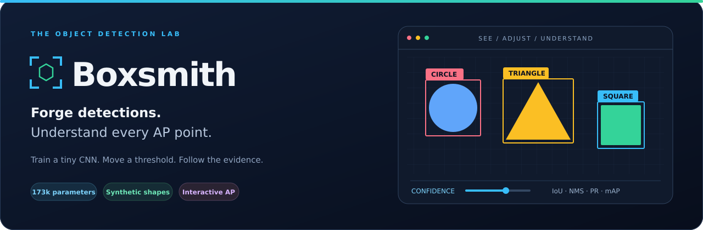
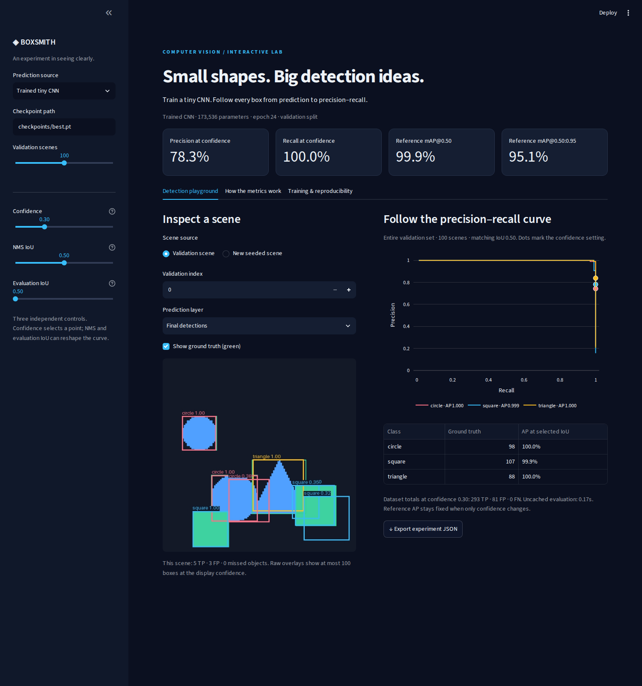
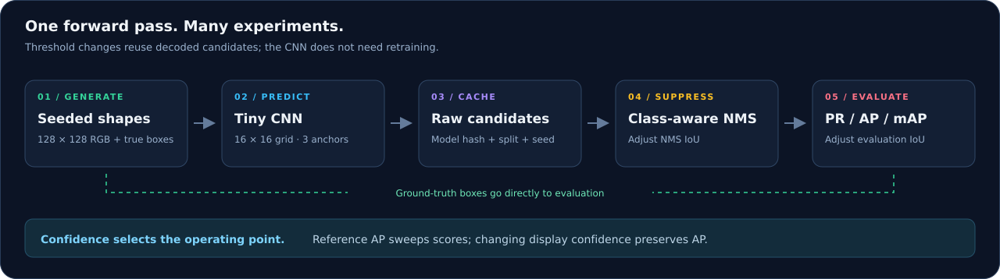

# Boxsmith



<p align="center">
  <a href="https://github.com/rivindu02/boxsmith/actions/workflows/test.yml"></a>
  <a href="https://github.com/rivindu02/boxsmith/releases"></a>
  <a href="pyproject.toml"></a>
  <a href="LICENSE"></a>
</p>

**An interactive object detection lab you can train, inspect, and understand.**
Boxsmith trains a tiny CNN from scratch on colourful shapes with automatically
generated bounding boxes. Move a threshold and follow its effect on detections,
precision–recall curves, average precision (AP), and mean average precision (mAP).

**[Quick start](#quick-start)** · **[First experiment](#your-first-experiment)** ·
**[Train](#train-your-own-detector)** · **[Results](#measured-results)** ·
**[Troubleshooting](#troubleshooting)** · **[Improvement roadmap](docs/ROADMAP.md)**

## What you can explore

| In the lab | What you learn |
| --- | --- |
| Circles, squares, and triangles generated from a seed | Detection data, automatic annotations, and reproducible splits |
| A 173,536-parameter CNN with three anchor sizes | Objectness, class prediction, and bounding-box regression |
| Ground truth → raw candidates → NMS → final detections | Where duplicates and false positives come from |
| Independent confidence, NMS IoU, and evaluation IoU controls | The difference between ranking, suppression, and matching |
| Per-class PR curves, AP, and dataset mAP | Why a high score at one threshold does not describe the full detector |
| Controlled error examples and experiment JSON downloads | How to reproduce and explain a detection failure |

You can use the **released model**, **train your own**, or start immediately with
**controlled examples**. Controlled predictions are labelled separately from model outputs.
No dataset download or GPU is required to explore the app.

<details>
<summary><strong>View the running playground</strong></summary>



The screenshot shows the trained model on 100 validation scenes. The published
benchmark below uses 500 scenes per split, so its aggregate numbers differ.

</details>

## Quick start

The complete CPU lock is **tested on Linux x86-64 with Python 3.12**. It includes
the app and test dependencies. Allow disk space for PyTorch and its dependencies;
the small checkpoint itself is only about **703 KiB**.

```sh
git clone https://github.com/rivindu02/boxsmith.git
cd boxsmith

python3.12 -m venv .venv
. .venv/bin/activate
python -m pip install -r requirements-cpu.lock.txt
python -m pip install --no-deps -e .

python -m boxsmith.fetch_checkpoint
python -m streamlit run app.py --server.address 127.0.0.1
```

Open **<http://localhost:8501>**. The app uses `checkpoints/best.pt` automatically.
The download command retrieves the [v0.1.0 checkpoint](https://github.com/rivindu02/boxsmith/releases/tag/v0.1.0)
and verifies its pinned SHA-256 before saving it.

**Try the concepts before downloading weights:** skip `boxsmith.fetch_checkpoint`
and launch the app. When no default checkpoint exists, it opens in **Controlled examples**.
The Python dependencies are still needed.

For a CUDA environment, install a compatible PyTorch build first, then install
`requirements-dev.txt` and this package. Use a separate environment from the CPU
lock. See [environment notes](docs/ENVIRONMENT.md) and
[PyTorch installation options](https://pytorch.org/get-started/locally/).
Other Python versions and operating systems have not been validated for this release.

## Your first experiment

Start with **100 validation scenes**, confidence **0.30**, NMS IoU **0.50**, and
evaluation IoU **0.50**. The image panel explains one scene; the curves and cards
summarize the entire selected validation set.

| Try this | What to watch |
| --- | --- |
| Move **Confidence** from 0.30 to 0.80 | Visible boxes and PR dots change. Reference AP stays fixed. |
| Select **Controlled examples → Duplicates**, then change NMS IoU from 1.00 to 0.50 | Duplicate boxes disappear; their effect on dataset PR/AP changes. |
| Select **Wrong classes** | A well-positioned box still fails to match when the class is wrong. |
| Select **Loose boxes** and compare with green truth | The shrunken boxes fail IoU 0.50 despite predicting the right classes. |
| Select **Perfect detections** | Reference AP reaches 100% on the generated validation set. |
| Switch **Prediction layer** between raw candidates, after NMS, and final detections | Follow the same model output through postprocessing. |
| Choose **New seeded scene** and change its index | Inspect a reproducible scene outside the displayed validation set. The dataset curves still describe validation. |

**Green outlines are ground truth.** Predicted outline colours identify the shape
class; they do not currently indicate TP/FP status. The scene caption gives TP, FP,
and missed-object counts at the selected confidence. Raw overlays show at most 100 boxes.

Use **Export experiment JSON** to save the scene identity, thresholds, checkpoint
hash, counts, and aggregate metrics. The app currently exports settings; importing
or replaying that JSON is a [planned improvement](docs/ROADMAP.md#4-teaching-and-interface-improvements).

## Understand the three thresholds

| Control | Its job | Effect on reference AP |
| --- | --- | --- |
| **Confidence** | Select a score cutoff for visible detections and the highlighted operating point | Unchanged: reference AP uses the full score sweep |
| **NMS IoU** | Suppress a lower-scored box if its overlap with a retained box of the same class exceeds this value | Can change which predictions enter the curve |
| **Evaluation IoU** | Set the minimum overlap needed to match a prediction to same-class ground truth | Changes the selected-IoU curves and per-class AP |

The headline reference cards always report **mAP@0.50** and **mAP@0.50:0.95**.
The evaluation-IoU slider changes the selected curves, per-class table, and counts;
it does not redefine those fixed reference metrics.

| Term | Definition |
| --- | --- |
| **IoU** | Intersection area divided by union area |
| **TP / FP / FN** | Matched prediction / unmatched prediction / missed ground-truth object |
| **Precision** | TP / (TP + FP) |
| **Recall** | TP / (TP + FN) |
| **AP** | Precision envelope averaged at 101 recall levels over the confidence sweep |
| **mAP@0.50** | Mean class AP at matching IoU 0.50 |
| **mAP@0.50:0.95** | Mean AP across classes and ten IoUs: 0.50, 0.55, …, 0.95 |

Each ground-truth object can be matched only once. Duplicates count as false
positives. A class with no ground truth has undefined AP and is excluded from
mAP; a class with ground truth but no predictions has AP 0. Operating-point
precision/recall display 0 when their denominator is 0.

## How it works



The backbone uses five convolution blocks with 24, 40, 64, 96, and 96 channels.
The first three downsample, producing a **16 × 16** feature grid for a **128 × 128**
image. Three anchors per location produce **768 candidates**. Each predicts
objectness, three class logits, and four box offsets. Confidence is objectness
probability multiplied by the highest class probability.

Scenes contain 0–6 objects with 16–36 pixel bounds. Colour is sampled independently
of class. Train, validation, test, and new-scene namespaces use separate deterministic
seeds. Annotations come directly from shape geometry; images need not be saved to disk.

Inference results are cached by checkpoint hash, generator identity, split, seed,
and decoding version. Threshold adjustments reuse candidates, and the app caches
the full ten-IoU sweep. Matching and NMS use stable score ordering.

## Train your own detector

Run commands from the repository root with the environment activated.
Start with a short CPU smoke run in a fresh output directory:

```sh
python -m boxsmith.train \
  --device cpu --epochs 2 --train-count 64 --val-count 32 \
  --output runs/smoke
```

This checks execution; two epochs are not a quality benchmark. For the full
baseline, use the checked-in configuration:

```sh
# Works in the CPU setup above; training takes longer than on a GPU.
python -m boxsmith.train \
  --config configs/tiny-shapes.yaml --device cpu --output runs/my-baseline

# In a CUDA environment, select one available GPU explicitly instead.
python -m boxsmith.train \
  --config configs/tiny-shapes.yaml --device cuda:0 --output runs/my-gpu-baseline
```

| Baseline setting | Value |
| --- | --- |
| Training / validation scenes | 4,000 / 500 |
| Epochs / batch size | 32 / 64 |
| Optimizer / initial learning rate | AdamW / 0.002 |
| Learning-rate schedule | Cosine |
| Seed / evaluation frequency | 42 / every 4 epochs, plus first and last |

Change scene settings in [configs/tiny-shapes.yaml](configs/tiny-shapes.yaml).
CLI overrides are available for epochs, training count, and validation count.
Training caches images in RAM; the default 4,000 float image tensors alone use
about 750 MiB. Use smaller counts for a first run.

Each run writes `config.json`, `history.jsonl`, `best.pt`, and `latest.pt`.
`best.pt` is selected by evaluation mAP@0.50. Existing runs are protected from
overwrite: use a new `--output` path. **Resume is not implemented yet.**

<details>
<summary><strong>Diagnostic: deliberately overfit a tiny dataset</strong></summary>

```sh
python -m boxsmith.train --device cpu \
  --train-count 64 --val-count 32 --epochs 160 --overfit \
  --output runs/overfit-diagnostic
```

`--overfit` evaluates on training scenes. Its result checks whether the pipeline
can learn; it is not held-out validation performance. The current JSONL field is
still called `val_map50`; checkpoint metadata records `evaluation_split: train`.

</details>

## Evaluate and use a checkpoint

Evaluate the release checkpoint with distinct report paths:

```sh
python -m boxsmith.evaluate checkpoints/best.pt \
  --split val --count 500 --output outputs/validation.json

python -m boxsmith.evaluate checkpoints/best.pt \
  --split test --count 500 --output outputs/test.json
```

Evaluation defaults to CPU. Optional controls include `--device cuda:0`,
`--nms-iou 0.50`, and `--cache /path/with/space/cache`. Reports include per-class
AP, mAP, dataset identity, checkpoint hash, evaluation settings, and stage timings.
Use validation for tuning and reserve test for the final report.

Point the app at your own trained model:

```sh
BOXSMITH_CHECKPOINT=runs/my-baseline/best.pt \
  python -m streamlit run app.py --server.address 127.0.0.1
```

| App environment variable | Default | Purpose |
| --- | --- | --- |
| `BOXSMITH_CHECKPOINT` | `checkpoints/best.pt` | Default trained-model path; also editable in the sidebar |
| `BOXSMITH_CACHE` | `cache` | Persistent raw-prediction cache directory |

## Measured results

The baseline was trained from scratch on 4,000 scenes using seed 42. Epoch 24 was
selected by validation mAP@0.50 from a 32-epoch run; test did not select the model.

| Split | Scenes | mAP@0.50 | mAP@0.50:0.95 |
| --- | ---: | ---: | ---: |
| Validation | 500 | **99.89%** | **95.33%** |
| Test | 500 | **99.57%** | **95.55%** |

These scores describe **simple synthetic shapes**, not photographs or real-world
generalization. The background, shape sizes, and overlap range are intentionally
limited. Evaluation uses no-crowd, all-area, COCO-style AP with score floor 0.001
and a post-NMS cap of 100 detections per image; full COCO support is not claimed.

| Interaction on 500 validation scenes | Measured Python rerun |
| --- | ---: |
| Confidence change | 0.29 s |
| Evaluation-IoU change | 0.30 s |
| Previously uncached NMS setting | 1.58 s |

Timings exclude browser/network latency and depend on server load. See
[full results and limitations](docs/RESULTS.md), [raw reports](docs/reports), and
[training history](docs/reports/training.jsonl) for the evidence.

## Server development through SSHFS

On this setup, edit and commit from **`~/mnt/entc/Rivindu/boxsmith`** locally.
Run Python over **`ssh entc`** in `~/Rivindu/boxsmith` on the server.
The app is managed in a server tmux session named `boxsmith`.

```sh
# Local terminal: forward the running server app.
ssh -N -L 8501:127.0.0.1:8501 entc
```

Open <http://localhost:8501>. If the server app needs starting, in another terminal:

```sh
ssh entc
cd ~/Rivindu/boxsmith
export BOXSMITH_CACHE=/mnt/minura/tmp/boxsmith-ravindu/cache
/mnt/minura/tmp/boxsmith-ravindu/venv/bin/python -m streamlit run app.py \
  --server.address 127.0.0.1 --server.port 8501
```

The server root disk is nearly full. Put new environments, training `--output`,
and evaluation `--cache`/`--output` paths on a writable larger volume. Existing
artifacts use `/mnt/minura/tmp/boxsmith-ravindu`; temporary storage is not durable.
See [environment notes](docs/ENVIRONMENT.md) for recovery and exact paths.

## Troubleshooting

| Symptom | What to do |
| --- | --- |
| `python3.12` is not found | Install Python 3.12 for your platform before creating the environment. |
| `No module named boxsmith` | Activate the environment and run `python -m pip install --no-deps -e .` from the repository root. |
| App opens in Controlled examples | Download the checkpoint, set `BOXSMITH_CHECKPOINT`, or choose an existing checkpoint path in the sidebar. |
| A low confidence shows extra boxes | Inspect the layers and raise confidence. NMS suppresses same-class overlaps; it does not remove every class error. |
| AP does not move with confidence | Expected: confidence selects an operating point. Change NMS or inspect AP at a different evaluation IoU. |
| Validation and test reports look identical on disk | Set different `--output` paths. The CLI's default report path is reused. |
| `Output already contains a run` | Choose a fresh training `--output`; training does not resume or overwrite an existing run. |
| Download refuses to overwrite a checkpoint | It found different file contents. Use `boxsmith.fetch_checkpoint --output checkpoints/release-best.pt`, then select that path. |
| CUDA is unavailable | The CPU lock installs CPU PyTorch intentionally. Use `--device cpu` or prepare a separate CUDA environment. |
| Port 8501 is already in use | Use the existing instance, or launch with `--server.port 8502` and forward to that port. |
| `No space left on device` on `entc` | Set environment, run, and cache locations on the larger writable volume described above. |
| Invalid YAML or a custom checkpoint causes a traceback | Start with the shipped config and verified release checkpoint; input validation is a known [roadmap item](docs/ROADMAP.md#2-input-validation-and-honest-evaluation-context). |

## Verify and contribute

```sh
python -m pytest -q
python -m pip check
```

The current suite has 13 tests covering hand-calculated AP, pycocotools parity on a
nontrivial no-crowd fixture, scene reproducibility, IoU/NMS edge cases, anchor
assignment, model backward execution, cache identity, checkpoint downloads, and
Streamlit interactions. GitHub Actions runs the pinned CPU environment.

Optional developer tools:

```sh
python scripts/benchmark_interactions.py  # Run with a trained checkpoint available.
python -m pip install playwright
python -m playwright install chromium --only-shell
python scripts/capture_preview.py        # Requires the app running on port 8501.
```

The [prioritized improvement review](docs/ROADMAP.md) is the best place to pick
the next task: shared-cache robustness, input validation, harder benchmarks,
per-box error explanations, and NMS performance. It records evidence and clear
completion checks. For a contribution, describe the observed behavior, the change,
and the relevant validation; keep generated weights/data out of Git.

<details>
<summary><strong>Repository map</strong></summary>

```text
app.py                        Streamlit playground
configs/tiny-shapes.yaml       Baseline data and training settings
src/boxsmith/
  data.py                     Seeded scenes and annotations
  model.py / matching.py      CNN, box encoding, and training assignments
  train.py                    Training CLI and checkpoints
  predict.py / boxes.py       Inference cache, IoU, and class-aware NMS
  metrics.py / evaluate.py    Matching, PR/AP, and evaluation CLI
  examples.py                 Controlled detection errors
  visualization.py            Overlays and PR plots
  fetch_checkpoint.py         Verified release download
tests/                        Model, metric, cache, download, and app checks
docs/                         Results, reports, setup, designs, and roadmap
scripts/                      Browser preview and interaction timing
```

</details>

**License:** [MIT](LICENSE). **Design and original scope:** [implementation plan](docs/PLAN.md).
